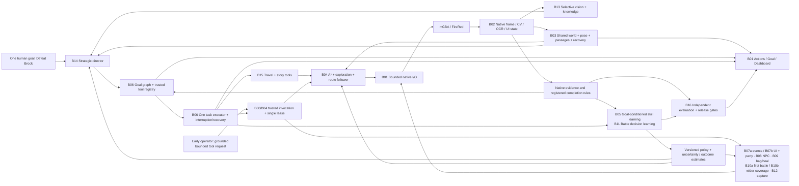

# Target architecture — one learning player, first campaign Brock

This is the intended design. The public starter includes presentation code only;
the [build index](stream_kit/prompts/brock/README.md) specifies what to implement. The diagram
page `stream_kit/architecture.html` is a self-contained 1920×1080 OBS source with
architecture, parts catalog and playable-checkpoint views. B IDs name components;
R0–R10 in the index is the actual dependency-aware build schedule. It does not control
the emulator or claim that planned components are running.

OBS Image Sources: [architecture.png](stream_kit/architecture.png) and
[build_order.png](stream_kit/build_order.png), both 1920×1080. These are static
2026-10-14 snapshots, not live progress indicators. build_order.png shows playable
R gates rather than numeric B order. Regenerate alongside HTML changes.

B00 defines isolated runtime/experiment profiles, canonical IDs, versioned interfaces,
storage/evidence ownership and event contracts. It applies to every box. SQLite
remains the persistence layer; there is one spatial map and one goal lifecycle.
“Memory” is a shared service, not a second independent coordinate system.

## Useful gameplay before the whole architecture exists

The final interfaces are built once, with capability-scoped slices. The displays
can start in view-only mode before gameplay imports exist. B04 supplies measured
navigation through a trusted operator invocation; B06 later uses that same entry
and B14 adds general AI planning. Early movement is therefore useful without a
temporary bedroom coordinator or an inaccurate claim of macro-goal autonomy.

At Oak, unsupported events hold; B07a adds motion/dialogue ownership and map
recovery. B07b adds sensed choices, grounded world interactables and native party
proof. B08 supplies general NPC interaction. B13/B14 can then use those tools for
the one-goal starter demonstration without waiting for inventory or capture.

B10a admits a narrow first-battle profile of the final battle executor. B11 can
learn that profile while B09 supplies healing/bag tools and B10b widens combat.
B15 adds longer travel/story interactions; B12 is optional capture, and B16 is
the full Brock admission/evaluation gate. Untested UI/action variants remain
unavailable. A slice receipt does not certify the whole component or campaign.

See the [playable sequence](stream_kit/prompts/brock/README.md) for exact dependencies,
demonstrations and stop boundaries, and [overlay operations](stream_kit/OVERLAY_OPERATIONS.md)
for startup/maintenance from an empty workspace.

## What learns

- **World knowledge:** measured traversability, connections, landmarks, relevant NPC
  facts, team/inventory and encounter outcomes, all with provenance and uncertainty.
- **Navigation/skill policy:** goal-conditioned option values from actual outcomes,
  measuring progress, expected action/time cost, unsuccessful probes and recoveries.
- **Battle policy:** choices conditioned on observed team/opponent/moves/resources,
  learned from verified turn/encounter outcomes and compared with a rule baseline.
- **Strategic adaptation:** the Director retrieves failure/skill estimates and
  revises its plan, choosing bounded exploration, training, healing or capture.
  Model claims never become ground truth or rewrite the reward function.

The foundation model need not change its weights for this project to learn.
However, cached text and a bigger model alone are insufficient: policy parameters
must change from recorded experience and demonstrate benefits under frozen tests.
Deterministic A*, menu selection and safety constraints remain useful executors.

## One decision cycle

1. Observe and classify the current native UI; establish or recover grounded state.
2. Retrieve only task-relevant facts and a compact capability/policy projection.
3. Continue the active supported task or plan a missing prerequisite beneath the root.
4. Execute through one specialized tool with legal actions and fresh evidence checks.
5. Record measured transitions, costs, uncertainty and completion/failure receipts.
6. In train mode, update registered learners; in evaluate/execute, keep policy fixed.
7. Replan on changed evidence; recover interrupts and retain the interrupted task.

Do not turn perception uncertainty into a guessed position, tactical loss or
learning reward. More repetitions of a broken controller are not useful training.

## From fresh checkout to evaluated player

Begin with the supplied overlays and create the gameplay code through the guides.
Each stage uses the tested interfaces built in its preceding stages and records
a versioned offline/live receipt. Record code, schema, configuration and fixture
hashes, and verify each capability in this workspace. Keep training, evaluation
and ordinary execution data isolated as defined by B00/B05. B16 evaluates this
completed player and records its release manifest using this build's evidence.

The clean build starts with these final interfaces and adds capabilities behind
them. It does not replay historical screenshots-only policies, stacked planners,
manual-per-goal success prompts or a special Brock button script.

For a Brock campaign, travel, service, encounter and team changes all return through
the same executor and evidence contracts. Native named-opponent win/badge evidence
with episode provenance completes the root. Outcome verification is reusable;
the Director chooses the prerequisite path from actual state.

The [FireRed Gym script](https://github.com/pret/pokefirered/blob/master/data/maps/PewterCity_Gym/scripts.inc)
is external design knowledge for Brock's battle/reward sequence. It is not runtime
state evidence; the player continues to use screenshots rather than reading flags.
